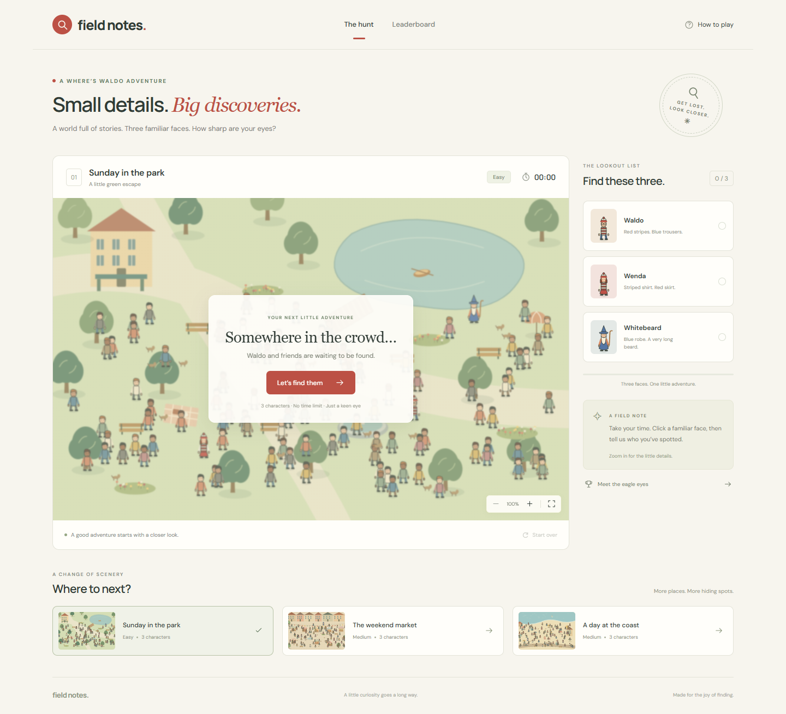

# Field Notes — Where’s Waldo?

A little curiosity goes a long way. Find Waldo, Wenda, and Whitebeard in three original illustrated worlds, tag the faces you spot, and leave your time in the field notes.

Built for [The Odin Project’s photo-tagging assignment](https://www.theodinproject.com/lessons/nodejs-where-s-waldo-a-photo-tagging-app), including the multiple-image extra credit.



## Run locally

Requires **Node.js 24 or newer**. There are no runtime package dependencies: the server uses Node’s HTTP and SQLite modules.

```sh
npm ci
npm start
```

Open **http://127.0.0.1:3000**. For automatic server reloads, use `npm run dev`.

The SQLite database is created and seeded in `data/waldo.sqlite` on the first run. Set `PORT`, `HOST`, or `DATABASE_PATH` in the process environment to override the defaults. `.env.example` documents these settings; the server does not automatically load `.env` files. To use a file, start with `node --env-file=.env server/index.js`.

## Play

1. Choose the park, market, or coast.
2. Start the hunt. The server starts the clock once the image has loaded and you press the start button.
3. Click a character and choose their name from the targeting menu. Incorrect guesses give feedback; correct guesses receive permanent markers.
4. Find all three. The server stops the clock on the final correct guess.
5. Enter an explorer name to save your result. Each scene has its own leaderboard.

Zoom controls enlarge the illustration. Scroll the scene to explore it. On narrow screens, the scene starts enlarged so the characters remain readable. Clicking outside the targeting menu or pressing Escape dismisses it. Keyboard users can focus the scene, move the cursor with the arrow keys (Shift for larger steps), and press Enter or Space to open the character list.

Refreshing the page restores the latest round, its found markers, and the server’s elapsed time. Background time counts. Anonymous rounds expire after 24 hours. Switching away from an unfinished hunt requires confirmation and abandons that round.

## Architecture

- **Frontend:** semantic HTML, responsive CSS, and vanilla JavaScript. No build step.
- **Backend:** Node HTTP server with JSON endpoints, input validation, same-origin write checks, request limits, and an HttpOnly anonymous session cookie.
- **Database:** SQLite with scene metadata, normalized target coordinates and tolerances, rounds, unique finds, and one score per completed round.
- **Artwork:** deterministic, original SVG illustrations and character portraits generated by `scripts/generate-scenes.js`. Generated scenes are committed and served as static image assets.

All image clicks use normalized coordinates (`0–1`) calculated from the displayed image’s bounding rectangle, so validation works at different viewport sizes and zoom levels. Target coordinates stay on the server. A successful attempt returns only the markers already earned.

Start and finish timestamps come from the server. The server derives score duration from those timestamps and ignores client-supplied times. A round belongs to the anonymous session that created it; other sessions cannot read or submit it. Names use parameterized SQL and are rendered with `textContent` in the leaderboard.

This protects against simple score and coordinate tampering. It is a learning project, not a bot-proof competition: players can study the public artwork, and anonymous request limits can be bypassed by replacing cookies. For a large public competition, add authenticated users and edge-level abuse protection.

### API

| Method | Endpoint                      | Purpose                                    |
| ------ | ----------------------------- | ------------------------------------------ |
| GET    | `/api/health`                 | Database-backed health check               |
| GET    | `/api/scenes`                 | Public scene and character metadata        |
| GET    | `/api/session`                | Restore the latest round for this session  |
| POST   | `/api/rounds`                 | Start a round with `{ sceneId }`           |
| GET    | `/api/rounds/:id`             | Read the owner’s progress and elapsed time |
| POST   | `/api/rounds/:id/attempts`    | Validate `{ characterId, x, y }`           |
| POST   | `/api/rounds/:id/abandon`     | Discard an unfinished round with `{}`      |
| POST   | `/api/rounds/:id/score`       | Save `{ name }` for a completed round      |
| GET    | `/api/leaderboard?scene=park` | Top 20 times for a scene                   |

## Verify

```sh
npm test
npx playwright install chromium
npm run test:browser
```

The API tests cover validation, ownership, expired sessions, hidden target coordinates, misses, all three scenes, fixed server timing, duplicate submissions, and score names. Browser tests play a complete hunt at desktop and mobile sizes, including zoom, reload, leaderboard submission, scene selection, modal confirmation, and keyboard tagging.

Browser tests run against an isolated in-memory database on port 3001. If Chromium cannot be downloaded but Chrome is installed, set `PLAYWRIGHT_CHANNEL=chrome`. GitHub Actions runs both suites on every push to `main` and every pull request.

## Deploy

`render.yaml` configures a Node 24 service, health checks, secure cookies, and a 1 GB persistent SQLite disk. Import this repository as a Render Blueprint. **The selected compute plan and persistent disk are paid resources. Review Render’s displayed price before creating the service.** Free ephemeral hosting loses SQLite data when its filesystem resets.

Use a single server instance with SQLite. Keep the disk mounted at `/var/data` and `DATABASE_PATH=/var/data/waldo.sqlite`. Back up the database regularly, including its WAL state, using SQLite’s backup tooling. Deploy behind HTTPS with `NODE_ENV=production`; production session cookies require HTTPS.

Alternatively, build the Docker image and mount a persistent volume at `/app/data`. Use `NODE_ENV=development` only for a local HTTP smoke test:

```sh
docker build -t waldo-field-notes .
docker run --rm -p 3000:3000 -e NODE_ENV=development -v waldo-data:/app/data waldo-field-notes
```

## Add a scene

Add a scene and its character positions to `server/scenes.js`. Coordinates there refer to a `1440 × 900` source illustration; startup seeding converts them to normalized values in SQLite. Extend the artwork generator and run `npm run generate:scenes`. Keep target data out of public API metadata and frontend files. Seeding updates coordinates without deleting existing leaderboard entries; introduce a new scene ID if changing an existing puzzle substantially.

## Credits

An educational fan project inspired by Where’s Waldo. The illustrations were created specifically for this app and do not reproduce published puzzle artwork. Waldo and related character concepts belong to their respective rights holders. UI typography uses DM Sans and Manrope through Google Fonts, with system font fallbacks.
